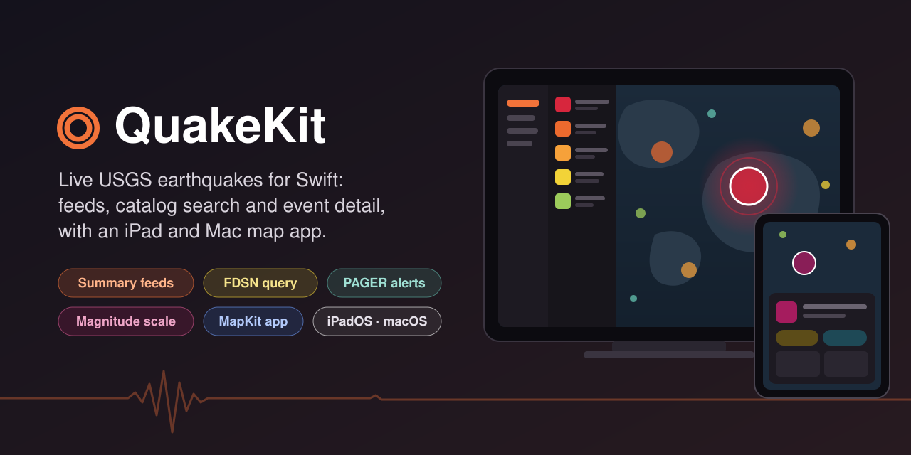
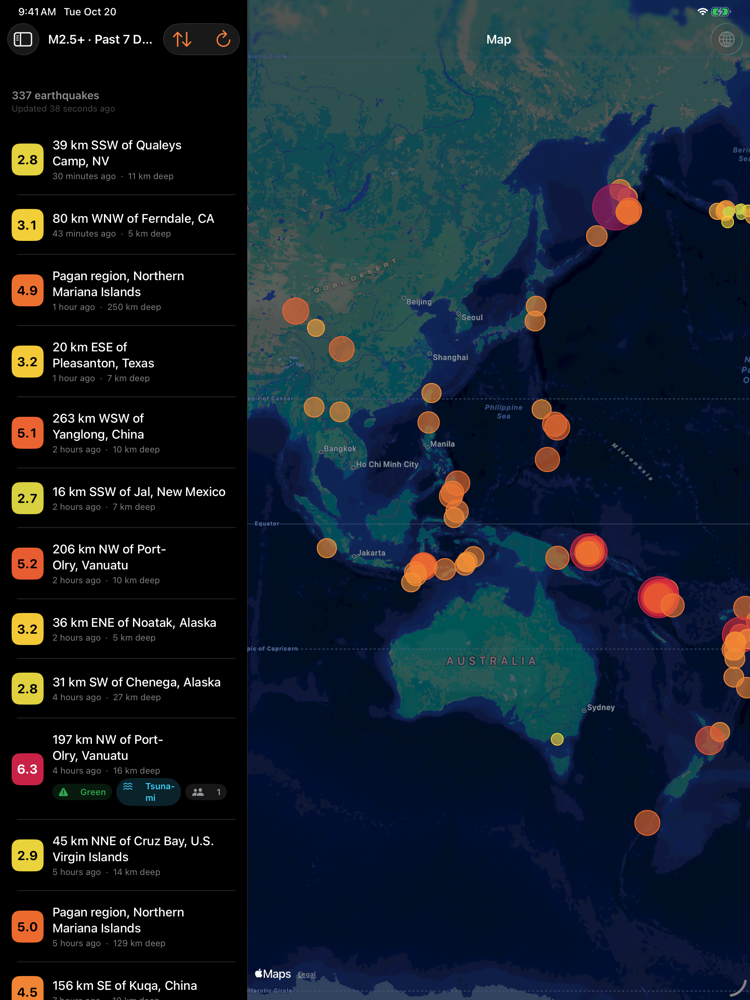
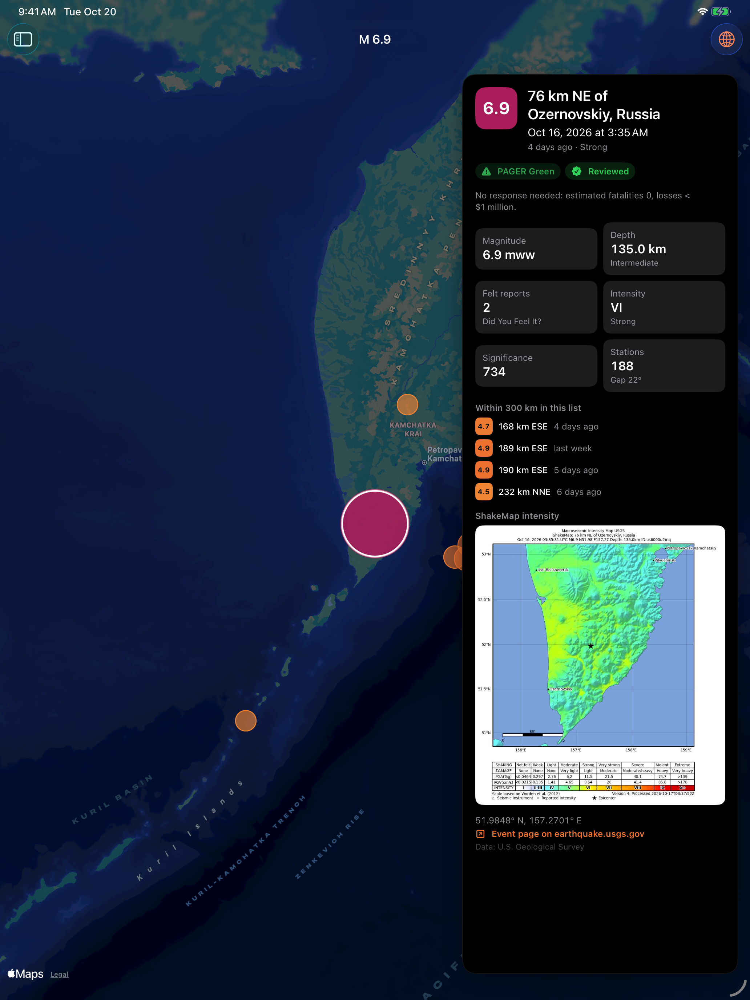
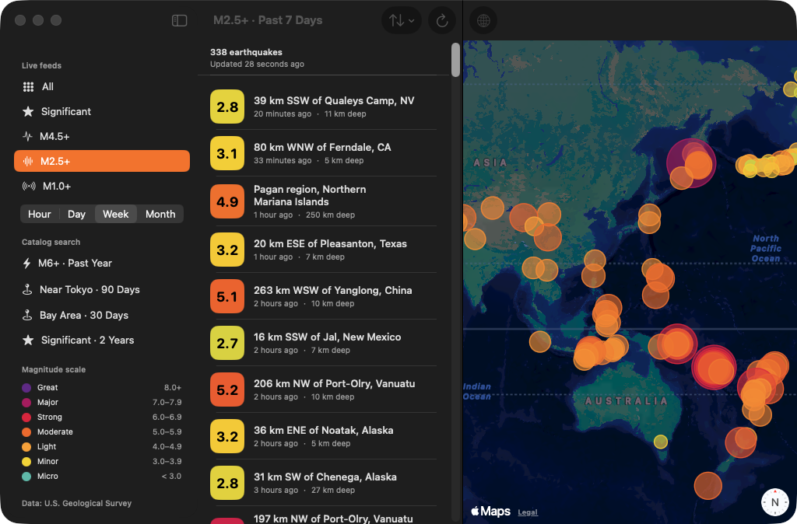
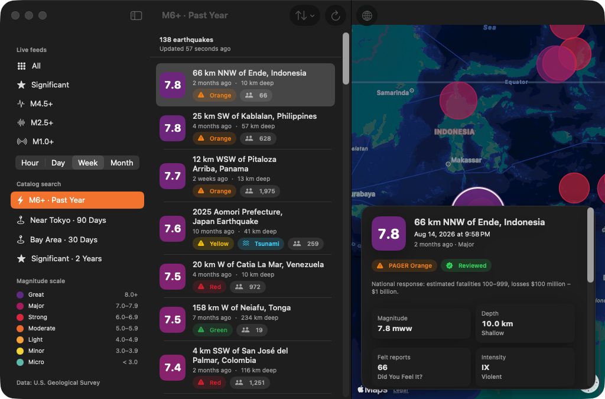

<p align="center">
  
</p>

<p align="center">
  <a href="https://github.com/halilozel1903/QuakeKit/actions/workflows/ci.yml"></a>
  
  
  
  
  
  <a href="LICENSE"></a>
</p>

**QuakeKit** is a Swift client for the U.S. Geological Survey's [real-time earthquake feeds](https://earthquake.usgs.gov/earthquakes/feed/v1.0/geojson.php) and the [FDSN event web service](https://earthquake.usgs.gov/fdsnws/event/1/), with an example MapKit app for **iPad and Mac**. Load the summary feeds, search the whole catalog by time, magnitude, depth and area, count matches without downloading them, and open an event's detail with its felt reports, tsunami flag, PAGER alert level, ShakeMap and location quality. Typed GeoJSON models, a magnitude color scale and distance helpers are included. No API key, no dependencies.

```swift
import QuakeKit

let usgs = QuakeClient()

// A real-time summary feed: magnitude 4.5 and above, past 7 days.
let week = try await usgs.feed(.m4_5, .week)
week.strongest?.magnitudeLabel          // "M 6.4"
week.strongest?.place                   // "112 km E of Hachinohe, Japan"

// The whole catalog: M5+ within 500 km of Tokyo in the past 90 days, largest first.
var query = EventQuery.around(GeoCoordinate(latitude: 35.68, longitude: 139.77),
                              radiusKilometers: 500, days: 90, minMagnitude: 5)
query.orderBy = .magnitude
let nearTokyo = try await usgs.events(query)
let total = try await usgs.count(query).count

// One event's detail.
let detail = try await usgs.detail(for: week.earthquakes[0])
detail.feltReports                      // "Did You Feel It?" responses
detail.hasTsunamiFlag
detail.alertLevel                       // .green, .yellow, .orange or .red
```

## Screenshots

Captured by CI from the example app, *Quake Watch*, on an iPad simulator and on the Mac, with live data from the USGS feeds and FDSN event service and live Apple Maps tiles. They show whatever the feeds held on the day of the last capture; nothing in them is bundled or made up.

| iPad: the past week on the map | iPad: event detail |
| :---: | :---: |
|  |  |





## Features

- **Summary feeds**: `feed(_:_:)` loads any of the 20 GeoJSON summary feeds, `{all|significant|4.5|2.5|1.0}_{hour|day|week|month}.geojson`, regenerated by the USGS every minute.
- **Catalog search**: `events(_:)` sends an `EventQuery` to the FDSN `query` method with a time range, magnitude and depth limits, a circle (center and radius in km) or a rectangle, PAGER alert level, minimum felt reports, event and product type, significance, `limit`, `offset` and order. Queries are checked before anything is sent; "204 No Content" is an empty result.
- **Counts**: `count(_:)` asks the FDSN `count` method how many events match, and whether that is over the 20,000 a query may return.
- **Event detail**: `detail(for:)` follows an event's `detail` URL, `detail(id:)` asks by any of its ids. `EventDetail` has every product (`origin`, `dyfi`, `losspager`, `shakemap`, `moment-tensor`…) in preference order, with shortcuts for felt reports, the PAGER alert level, the tsunami flag, reported and estimated intensity, the ShakeMap image, magnitude type, stations used, azimuthal gap and location errors.
- **Typed GeoJSON**: `QuakeFeed` (metadata, events, bounding box), `Earthquake` (every documented property: `mag`, `magType`, `place`, `time`, `updated`, `felt`, `cdi`, `mmi`, `alert`, `status`, `tsunami`, `sig`, `net`, `code`, `ids`, `sources`, `types`, `nst`, `dmin`, `rms`, `gap`, `type`, `title`) and `Hypocenter`. Times become `Date`, comma lists become arrays, and decoding is lenient: a null, a number sent as text or one malformed feature doesn't fail the feed.
- **Magnitude scale**: `MagnitudeScale.color(for:)` blends from teal at M1 through yellow and orange to red and purple at M8; `markerDiameter(for:)` and `radiusMeters(for:)` size map circles; `MagnitudeClass` names the classes (micro to great); energy helpers compare magnitudes. Colors are framework-free `QuakeColor` values with a SwiftUI `Color` bridge.
- **Distances**: `GeoCoordinate` has haversine `distance(to:)`, `bearing(to:)`, `destination(kilometers:bearing:)` and Core Location bridging; `CompassPoint` and `QuakeDistance` make labels like `142 km W`. Lists of events sort by distance, filter by radius and find an event's `neighbors(of:within:)`.
- **Robust**: 429, 500, 502, 503 and 504 answers, timeouts and lost connections are retried with backoff, honoring `Retry-After`. FDSN's plain-text error messages are surfaced in `QuakeError.badRequest`.
- **Testable and Swift 6 ready**: `Sendable` throughout; point the client at any `URLSession` and base URLs. The package's tests answer every request from a `URLProtocol` stub and fixtures, never the network. Tested with Swift Testing on macOS and on an iPad simulator.

## API coverage

| Endpoint | Method |
| --- | --- |
| `GET /earthquakes/feed/v1.0/summary/{magnitude}_{period}.geojson` | `feed(_:_:)`, `feed(_:)` → `QuakeFeed` |
| `GET /fdsnws/event/1/query?format=geojson&…` | `events(_:)` → `QuakeFeed` |
| `GET /fdsnws/event/1/count?format=geojson&…` | `count(_:)` → `EventCount` |
| `GET /earthquakes/feed/v1.0/detail/{id}.geojson` (an event's `detail` URL) | `detail(for:)` → `EventDetail` |
| `GET /fdsnws/event/1/query?eventid={id}&format=geojson` | `detail(id:)` → `EventDetail` |
| a product file, such as a ShakeMap image | `contentData(from:)` → `Data` |

| `EventQuery` property | FDSN parameter |
| --- | --- |
| `startTime`, `endTime` | `starttime`, `endtime` (UTC, ISO 8601) |
| `minMagnitude`, `maxMagnitude` | `minmagnitude`, `maxmagnitude` |
| `minDepth`, `maxDepth` | `mindepth`, `maxdepth` (km) |
| `area: .circle(center:radiusKilometers:)` | `latitude`, `longitude`, `maxradiuskm` |
| `area: .rectangle(…)` | `minlatitude`, `maxlatitude`, `minlongitude`, `maxlongitude` |
| `alertLevel`, `minFelt`, `minSignificance` | `alertlevel`, `minfelt`, `minsig` |
| `eventType`, `productType` | `eventtype`, `producttype` |
| `limit`, `offset`, `orderBy` | `limit` (1–20,000), `offset` (from 1), `orderby` |

## Installation

In Xcode choose **File › Add Package Dependencies…** and enter:

```
https://github.com/halilozel1903/QuakeKit
```

Or add it to `Package.swift`:

```swift
dependencies: [
    .package(url: "https://github.com/halilozel1903/QuakeKit", from: "1.0.0")
],
targets: [
    .target(name: "MyApp", dependencies: [
        .product(name: "QuakeKit", package: "QuakeKit"),
    ])
]
```

## Usage

### Summary feeds

```swift
let usgs = QuakeClient()

let feed = try await usgs.feed(.significant, .month)
feed.metadata.title           // "USGS Significant Earthquakes, Past Month"
feed.metadata.generated       // when the USGS built it
feed.earthquakes              // newest first
feed.sorted(by: .largest)     // also .newest, .oldest, .smallest, .shallowest, .deepest
feed.filtered(minimumMagnitude: 6)
feed.countsByClass[.strong]   // events from 6.0 to 6.9

for feed in SummaryFeed.all { print(feed.fileName) }   // all_hour.geojson … 1.0_month.geojson
```

### Events

```swift
let quake = feed.earthquakes[0]
quake.magnitude                // 6.4
quake.properties.magnitudeType // "mww"
quake.place                    // "112 km E of Hachinohe, Japan"
quake.time                     // Date
quake.coordinate               // GeoCoordinate(latitude:longitude:)
quake.depthKilometers          // 35.2
quake.location.depthClass      // .shallow, .intermediate or .deep
quake.alertLevel               // PAGER level, when assessed
quake.hasTsunamiFlag           // oceanic region covered by NOAA's warning centers
quake.feltReports              // "Did You Feel It?" responses
quake.properties.significance  // 0…1000+
quake.properties.url           // the event page on earthquake.usgs.gov
```

### Catalog search and counts

```swift
// M6+ anywhere in the past year, at most 400, newest first.
let strong = try await usgs.events(.recent(days: 365, minMagnitude: 6, limit: 400))

// A rectangle over California, deep events only, largest first.
var query = EventQuery(start: Date().addingTimeInterval(-30 * 86_400),
                       minMagnitude: 2.5,
                       area: .rectangle(minLatitude: 32, maxLatitude: 42,
                                        minLongitude: -125, maxLongitude: -114),
                       orderBy: .magnitude)
query.minDepth = 20
let deep = try await usgs.events(query)

let count = try await usgs.count(query)
count.count          // matches in the catalog
count.exceedsLimit   // more than one query may return

query.problem        // why the service would refuse it, or nil
```

### Event detail

```swift
let detail = try await usgs.detail(for: quake)     // or usgs.detail(id: "us7000abcd")
detail.feltReports                 // felt, or the DYFI product's responses
detail.maxReportedIntensity        // from "Did You Feel It?"
detail.maxEstimatedIntensity       // from ShakeMap
MercalliIntensity.roman(detail.maxEstimatedIntensity ?? 0)   // "VI"
detail.alertLevel?.response        // "Local or regional response"
detail.shakemapIntensityImageURL
detail.stationsUsed
detail.azimuthalGap
detail.origin?.string("review-status")
detail.products["moment-tensor"]   // every product of a type, preferred first
```

### Magnitude colors and map circles

```swift
MagnitudeScale.color(for: 5.5).hexString      // between orange and red
MagnitudeScale.color(for: 5.5).color          // SwiftUI Color
Color.magnitude(quake.magnitude ?? 0)
MagnitudeScale.markerDiameter(for: 6.4)       // points, for annotations on a world map
MagnitudeScale.radiusMeters(for: 6.4)         // meters, for MapCircle at regional zoom
MagnitudeClass(magnitude: 7.1).name           // "Major"
MagnitudeScale.energyRatio(7, to: 6)          // about 32 times the energy
```

### Distances

```swift
let tokyo = GeoCoordinate(latitude: 35.6812, longitude: 139.7671)
quake.distance(from: tokyo).formatted()               // "512 km"
quake.distance(from: tokyo).formatted(miles: true)    // "318 mi"
CompassPoint(bearing: tokyo.bearing(to: quake.coordinate))   // .nne

feed.earthquakes.sorted(byDistanceFrom: tokyo)
feed.earthquakes.within(300, of: tokyo)
feed.earthquakes.neighbors(of: quake, within: 300)    // (earthquake, distance, direction)
```

### Configuration and errors

```swift
let usgs = QuakeClient(configuration: QuakeConfiguration(
    session: .shared,
    userAgent: "MyQuakes/1.0 (you@example.com)",
    maxRetries: 3,       // default 2
    timeout: 20
))

do {
    _ = try await usgs.detail(id: "us0000none")
} catch let error as QuakeError {
    switch error {
    case .notFound: break                          // unknown event or feed
    case .badRequest(let message, _): print(message)   // the service's reason
    case .http(let status, _, _): print(status)
    case .invalidQuery(let reason): print(reason)  // nothing was sent
    case .decoding, .transport, .invalidResponse: break
    }
}
```

## Example app

The `Example` folder contains *Quake Watch*, built with QuakeKit and MapKit, with one set of SwiftUI views for both platforms in a three-column `NavigationSplitView`:

- **Sidebar**: the five live feeds with a period picker (hour, day, week, month), four catalog searches (M6+ in the past year, near Tokyo, the Bay Area, significant events) and the magnitude color legend. On the Mac the sidebar has an opaque background.
- **List**: every event with its magnitude badge, place, time, depth, PAGER, tsunami and felt-report chips, the feed's update time and, for catalog searches, the total count. Sort by time, magnitude or depth.
- **Map**: a circle for every event, colored and sized by magnitude; tap one to select it.
- **Event detail**: magnitude and type, depth, felt reports, intensity, significance, stations and gap, the PAGER alert with its meaning, the tsunami flag, nearby events with distance and direction, the ShakeMap and a link to the USGS event page.

The project uses [XcodeGen](https://github.com/yonaskolb/XcodeGen) so no project file has to live in the repo:

```bash
brew install xcodegen
cd Example && xcodegen generate
open QuakeWatch.xcodeproj
```

Run `QuakeWatch` on an iPad simulator or `QuakeWatchMac` on your Mac. The app always uses the live services. Launch with `-screenshot map|detail` (iPad) or `-screenshot map|list` (Mac) to open a fixed scene, as CI does for the screenshots above; a scene reports ready once its live data is on screen and the map has had 12 seconds to load its tiles.

## Data source

Earthquake data comes from the **U.S. Geological Survey** Earthquake Hazards Program ([earthquake.usgs.gov](https://earthquake.usgs.gov)). USGS-authored data is in the **public domain** in the United States; please credit the U.S. Geological Survey when you show it ([USGS copyright and credits](https://www.usgs.gov/information-policies-and-instructions/copyrights-and-credits)). The feeds are updated every minute; please don't poll them more often than that, and prefer the summary feeds over repeated catalog queries for live data.

QuakeKit is an unofficial client, not affiliated with or endorsed by the USGS. PAGER alert levels and the tsunami flag are informational; for warnings, follow your local authorities and [tsunami.gov](https://www.tsunami.gov). The fixtures used by the unit tests are hand-written in the shapes of the USGS GeoJSON formats and do not describe real events; the app icon and banner are original artwork made for this package. Map tiles in the example app come from Apple Maps.

## Requirements

- Xcode 26 or later (Swift 6.2 toolchain)
- iPadOS 17+ or macOS 14+ (the library also runs on iOS 17+)

## Contributing

Issues and pull requests are welcome. Please run the tests before opening a PR:

```bash
swift test
bash scripts/test.sh iOS
```

## License

QuakeKit is available under the MIT license. See [LICENSE](LICENSE).
